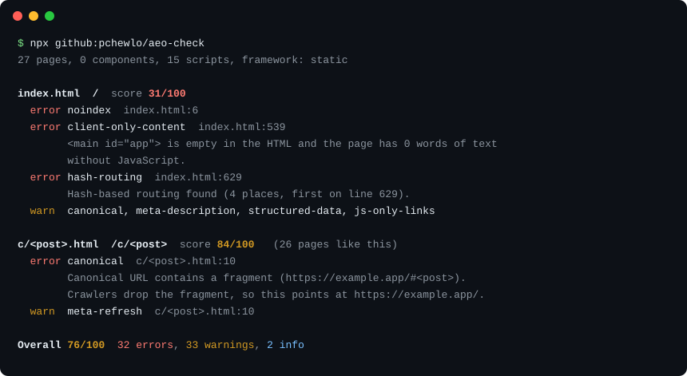

# AEO Checker

Answer engine optimisation (AEO) is making a site easy for ChatGPT, Claude, Perplexity, Gemini and Google's AI Overviews to fetch, understand and cite. AEO Checker reads a site's code (HTML, JSX/TSX, Vue, Svelte, Astro, Markdown, robots.txt, sitemap.xml, llms.txt) or a live URL and reports what gets in the way, with a file, line and fix for each finding, so it can run on every commit and pull request.

```sh
npx github:pchewlo/aeo-check https://your-site.com
```



You can also paste this repo's link into Claude Code, Codex or Cursor and ask it to check your site and fix what it finds.

## Install

Node 18 or later. No required dependencies; the Anthropic SDK is optional and only loaded by `--ai`.

```sh
npx github:pchewlo/aeo-check            # run once, no install
npm install -D github:pchewlo/aeo-check  # then: npx aeo-check
```

## Usage

```sh
aeo-check                          # check the current repository
aeo-check ./site                   # check a sub-folder
aeo-check https://example.com      # fetch a live page as a crawler does (no JavaScript)
aeo-check https://example.com --max-pages 20
aeo-check --since origin/main      # report only files changed on this branch
aeo-check --format json            # also: sarif, github, markdown
aeo-check --list-rules
```

| Option | Effect |
| --- | --- |
| `--format text\|json\|sarif\|github\|markdown` | Output format (default `text`) |
| `--output <file>` | Write the report to a file |
| `--sarif-output <file>`, `--markdown-output <file>` | Write extra reports alongside the main one |
| `--fail-on error\|warn\|info\|none` | Exit 1 when a finding reaches this severity (default `error`) |
| `--since <ref>`, `--changed-files <file>` | Check the whole site, report only changed files |
| `--rule <id>=error\|warn\|info\|off` | Change one rule's severity, or turn it off |
| `--only <id,id>` | Run only these rules |
| `--ignore <glob>` | Skip paths (repeatable) |
| `--site-url <url>` | Production URL, used for canonical and internal-link checks |
| `--max-pages <n>`, `--no-probe` | URL mode: pages to crawl; skip the AI user-agent probe |
| `--ai`, `--ai-model <id>`, `--ai-max-pages <n>` | Add the judgement rules (see below) |
| `--quiet`, `--no-color` | Shorter text output |

Passing file paths after the directory (`aeo-check . src/app/page.tsx`) checks the whole site and reports only those files. Exit codes: 0 clean, 1 findings at or above `--fail-on`, 2 usage error.

Each finding has a rule id, severity, location, the reason it matters for AI answers and a concrete fix. Pages get a score out of 100 (an error costs 12, a warning 4, an info 1, with each rule counted at most twice per page); the overall score is 60% the page average and 40% the site-level score.

### Config

`.aeo-check.json` (or an `aeoCheck` key in package.json):

```json
{
  "siteUrl": "https://example.com",
  "ignore": ["design-system/**", "*.bak.html"],
  "rules": { "thin-content": "info", "open-graph": "off" },
  "failOn": "error"
}
```

### Frameworks

Routes are worked out from Next.js (app and pages routers, including `metadata` exports and layout inheritance), Astro, SvelteKit, Nuxt, Gatsby, Remix and plain HTML. Markdown counts as a page when it sits in a content folder, has frontmatter, or a docs generator (MkDocs, Docusaurus, VitePress, Jekyll, Hugo, Eleventy) builds it.

## Rules

| Group | Rule | Default | Checks |
| --- | --- | --- | --- |
| Crawl access | `client-only-content` | error | Main content is in the server HTML |
|  | `crawler-access` | error | Firewall and CDN let AI crawlers through (URL mode) |
|  | `hash-routing` | error | Routes use real URL paths |
|  | `llms-txt-present` | warn | llms.txt exists |
|  | `llms-txt-valid` | error | llms.txt follows the spec |
|  | `meta-refresh` | warn | No meta refresh redirects |
|  | `noindex` | error | Important pages are indexable |
|  | `nosnippet` | warn | No nosnippet on content you want quoted |
|  | `robots-ai-search` | error | robots.txt lets AI search and answer crawlers in |
|  | `robots-ai-training` | info | Training crawlers blocked on purpose |
|  | `robots-txt` | info | robots.txt exists and points to the sitemap |
|  | `sitemap-lastmod` | warn | Sitemap entries carry a real lastmod |
|  | `sitemap-present` | warn | Sitemap exists |
| Metadata | `canonical` | warn | Each page declares a correct canonical URL |
|  | `duplicate-description` | warn | Meta descriptions are unique |
|  | `duplicate-title` | warn | Titles are unique |
|  | `html-lang` | warn | &lt;html> declares a language |
|  | `meta-description` | warn | Every page has a meta description |
|  | `open-graph` | info | Open Graph tags present |
|  | `title` | error | Every page has a specific &lt;title> |
|  | `ai-metadata-match` | warn | (--ai) Title and description match the content |
| Structure | `heading-order` | warn | Headings do not skip levels |
|  | `single-h1` | error | One H1 per page |
| Content | `ai-slop-phrases` | info | No stock AI-writing phrases |
|  | `answer-first` | warn | Sections open with a direct answer |
|  | `comparison-format` | info | Comparison and pricing pages use tables |
|  | `long-paragraphs` | warn | Paragraphs fit in one retrieval chunk |
|  | `question-headings` | info | Some headings match the questions people ask |
|  | `self-contained-passages` | info | Passages make sense on their own |
|  | `stats-need-sources` | info | Statistics link to their source |
|  | `table-headers` | warn | Tables have header cells |
|  | `thin-content` | warn | Pages have enough substance to cite |
|  | `ai-fanout-gaps` | info | (--ai) Page covers the sub-questions behind its topic |
|  | `ai-section-answers` | warn | (--ai) Each section answers its heading on its own |
| Trust | `author` | warn | Articles name a real author |
|  | `dates` | warn | Articles show when they were published and updated |
|  | `ai-claims-evidence` | info | (--ai) Claims sit beside their evidence |
| Structured data | `breadcrumbs` | info | Nested pages declare breadcrumbs |
|  | `faq-schema` | info | Question-and-answer content has FAQPage markup |
|  | `structured-data` | warn | Key pages carry schema.org JSON-LD |
|  | `structured-data-valid` | error | JSON-LD parses and has the required properties |
|  | `structured-data-visible` | warn | Structured data matches the visible page |
| Links | `internal-links` | warn | Content links to related pages |
|  | `js-only-links` | warn | Navigation uses real &lt;a href> links |
|  | `orphan-pages` | warn | Every page is linked from another page |
| Images | `facts-in-images` | warn | Pricing, comparisons and charts also exist as text |
|  | `img-alt` | warn | Images have alt text |
| Agent readiness | `accessible-names` | warn | Links and buttons have an accessible name |
|  | `agent-paths` | warn | Agents may reach product, booking and checkout paths |
|  | `commerce-facts` | warn | Prices and key policies are plain text in the HTML |
|  | `load-interstitials` | warn | No pop-ups or modals in front of the main content |
|  | `offer-schema` | warn | Commerce pages declare Offer data an agent can read |
|  | `primary-cta` | error | Book, Buy and Checkout are real links or buttons with text |

The four `--ai` rules send each content page's text (up to 10 pages, longest first) to Claude and need `ANTHROPIC_API_KEY`. They use `claude-opus-5` by default; change it with `--ai-model`. They are off unless you pass `--ai`.

## CI

### GitHub Action

Add `.github/workflows/aeo-check.yml` (also in [examples/aeo-check.yml](examples/aeo-check.yml)):

```yaml
name: AEO check
on:
  pull_request:
  push:
    branches: [main]
permissions:
  contents: read
  pull-requests: write
  security-events: write
jobs:
  aeo-check:
    runs-on: ubuntu-latest
    steps:
      - uses: actions/checkout@v4
      - uses: pchewlo/aeo-check@main
        with:
          path: .
          fail-on: error
```

On a pull request the action reports only the files the PR changes, annotates them inline, uploads SARIF to code scanning, keeps one summary comment up to date and fails the job on errors. Inputs: `path`, `url`, `fail-on`, `only-changed`, `sarif`, `comment`, `args`, `node-version`. SARIF upload on private repositories needs GitHub Advanced Security; without it the upload step fails without failing the job.

To check a deployed preview as crawlers see it, see [examples/aeo-check-preview.yml](examples/aeo-check-preview.yml).

### Pre-commit

With [pre-commit](https://pre-commit.com), add to `.pre-commit-config.yaml`:

```yaml
repos:
  - repo: https://github.com/pchewlo/aeo-check
    rev: main
    hooks:
      - id: aeo-check
```

Without it, copy [examples/pre-commit](examples/pre-commit) to `.git/hooks/pre-commit` (or call it from husky). Both check the whole site and report only staged files.

## Claude Code skill

[.claude/skills/aeo-check/SKILL.md](.claude/skills/aeo-check/SKILL.md) tells an agent how to run aeo-check, read the JSON, fix findings in the right order for the framework and re-run to confirm. Copy the folder into a project's `.claude/skills/` (or `~/.claude/skills/`) and ask Claude Code to "run aeo-check and fix what it finds". The skill tells the agent not to invent authors, dates, prices or sources, and to ask before removing a deliberate noindex.

## Example

A static single-page app that builds every view with `innerHTML` and routes with `#fragments`, plus 26 share-link pages that meta-refresh into those fragments. Old copies of the shell were skipped with `--ignore`. Output trimmed and the domain changed:

```text
$ aeo-check --ignore "index.*.html" --ignore "*.pre-*" --quiet
27 pages, 0 components, 15 scripts, framework: static

Site and shared files  score 67/100
  error noindex  vercel.json:35
        vercel.json sends an X-Robots-Tag noindex header, which keeps every matching route out of search indexes.
  error hash-routing  assets/videos.js:205
        Hash-based routing found (1 place, first on line 205).
  warn  llms-txt-present  llms.txt
  warn  sitemap-present  sitemap.xml
  info  robots-txt  robots.txt

index.html  /  score 31/100
  error single-h1  index.html:1
  error noindex  index.html:6
  error client-only-content  index.html:539
        <main id="app"> is empty in the HTML and the page has 0 words of text without JavaScript. Inline script writes it with innerHTML (line 606).
  error hash-routing  index.html:629
        Hash-based routing found (4 places, first on line 629).
  warn  canonical, meta-description, structured-data, js-only-links ...

c/<post>.html  /c/<post>  score 84/100   (26 pages like this)
  error canonical  c/<post>.html:10
        Canonical URL contains a fragment (https://example.app/#<post>). Crawlers drop the fragment, so this points at https://example.app/.
  warn  meta-refresh  c/<post>.html:10
        Meta refresh redirect to /#<post>.

Overall 76/100  32 errors, 33 warnings, 2 info
```

An AI crawler fetching this site gets an empty `<main>` and a noindex header, and every share link resolves to the home page. Fix them in the order shown. Drop the noindex if the site should be found, prerender each view to its own path, then give each page its own canonical, title and description.

## Limits

aeo-check reads source code. Text that a component, CMS or database supplies at build or request time is invisible to it, so rules that need the full text (thin content, author, dates) skip or soften findings on those pages. Run it against a deployed URL to check what crawlers receive. URL mode does not run JavaScript, which matches how GPTBot, ClaudeBot and PerplexityBot fetch pages. The `--ai` rules give a model's judgement and can be wrong.

## Sources

Rules cite these in their `why` text and in the SARIF help.

Posts on X (collected October 2026):

- [@Jingg_n_Tonic, quoting @metehan777's look inside ChatGPT's retrieval stream](https://x.com/Jingg_n_Tonic/status/2097252340973617458): answer within each section; pages become markdown-like text cut into ~170-word blocks; one to three blocks per source reach the model; keep claims beside their evidence; label tables; keep metadata specific
- [@Kasra_Dash](https://x.com/Kasra_Dash/status/2098379471615111583): cited for 5,000+ phrases by writing for each model's query fan-outs
- [@mal_shaik](https://x.com/mal_shaik/status/2094859359004373352): pages that answer the problem get cited over pages that pitch the product
- [@RobHoffman_](https://x.com/RobHoffman_/status/2099577674763243765): the comparison, alternatives and "best X for Y" pages that drive conversions, interlinked
- [@LottiSchmitt](https://x.com/LottiSchmitt/status/2096967274343047324): deleting 200 thin AI-written posts tripled Google traffic
- [@danielkbuilds](https://x.com/danielkbuilds/status/2096917237105885412): pages that do not index usually fail on content quality
- [@suraj_sharma14](https://x.com/suraj_sharma14/status/2106240327569035424): the SEO checklist for vibe-coded sites (server rendering, sitemap, noindex, canonicals, one H1, FAQ schema, breadcrumbs, orphan pages, alt text, author bio)
- [@boringlocalseo](https://x.com/boringlocalseo/status/2025616604512604454): recent, structured content with comparison tables
- [@codyschneider on refreshing pages](https://x.com/codyschneider/status/2085516293164134861) and [on schema and internal linking](https://x.com/codyschneider/status/2028500579501183024)
- [@ericciarla](https://x.com/ericciarla/status/1899490834862809139): llms.txt
- [@RoundtableSpace](https://x.com/RoundtableSpace/status/2092609257338200469): agent skill list including [claude-seo](https://github.com/AgriciDaniel/claude-seo)

Agent readiness:

- Larne, "Agents don't read your brand book", [Getting CEOs to trust CMOs](https://gettingceostotrustcmos.substack.com) (October 2026): four AI assistants asked to book one hotel night direct, one succeeded. The booking engine blocked automated access, the main "Book Now" buttons were blank links, the one success took nine steps, and the cancellation policy, written as plain text, was the one fact every agent got right.

Documentation:

- Crawlers: [OpenAI](https://developers.openai.com/api/docs/bots), [Anthropic](https://support.claude.com/en/articles/8896518-does-anthropic-crawl-data-from-the-web-and-how-can-site-owners-block-the-crawler), [Perplexity](https://docs.perplexity.ai/guides/bots), [Google (incl. Google-Extended)](https://developers.google.com/search/docs/crawling-indexing/google-common-crawlers), [Apple (Applebot-Extended)](https://support.apple.com/en-us/119829), [Bing](https://www.bing.com/webmasters/help/which-crawlers-does-bing-use-8c184ec0), [RFC 9309](https://www.rfc-editor.org/rfc/rfc9309)
- Google: [AI features and your website](https://developers.google.com/search/docs/appearance/ai-features), [helpful content](https://developers.google.com/search/docs/fundamentals/creating-helpful-content), [crawlable links](https://developers.google.com/search/docs/crawling-indexing/links-crawlable), [JavaScript SEO](https://developers.google.com/search/docs/crawling-indexing/javascript/javascript-seo-basics), [robots meta and data-nosnippet](https://developers.google.com/search/docs/crawling-indexing/robots-meta-tag), [canonicals](https://developers.google.com/search/docs/crawling-indexing/consolidate-duplicate-urls), [sitemaps](https://developers.google.com/search/docs/crawling-indexing/sitemaps/build-sitemap), [title links](https://developers.google.com/search/docs/appearance/title-link), [snippets](https://developers.google.com/search/docs/appearance/snippet), [redirects](https://developers.google.com/search/docs/crawling-indexing/301-redirects), [images](https://developers.google.com/search/docs/appearance/google-images), [structured data policies](https://developers.google.com/search/docs/appearance/structured-data/sd-policies), [Article](https://developers.google.com/search/docs/appearance/structured-data/article), [FAQPage](https://developers.google.com/search/docs/appearance/structured-data/faqpage), [BreadcrumbList](https://developers.google.com/search/docs/appearance/structured-data/breadcrumb), [Organization](https://developers.google.com/search/docs/appearance/structured-data/organization), [merchant listings](https://developers.google.com/search/docs/appearance/structured-data/merchant-listing), [intrusive interstitials](https://developers.google.com/search/docs/appearance/avoid-intrusive-interstitials)
- [llms.txt specification](https://llmstxt.org/), [schema.org](https://schema.org/docs/schemas.html) and [Offer](https://schema.org/Offer), [Open Graph](https://ogp.me/), [W3C language declarations](https://www.w3.org/International/questions/qa-html-language-declarations), [W3C accessible names](https://www.w3.org/WAI/ARIA/apg/practices/names-and-descriptions/)
- [Vercel: The rise of the AI crawler](https://vercel.com/blog/the-rise-of-the-ai-crawler) (none of the major AI crawlers run JavaScript), [Cloudflare: changing the default to block AI crawlers](https://blog.cloudflare.com/content-independence-day-no-ai-crawl-without-compensation/)

## Licence

MIT. See [LICENSE](LICENSE).
